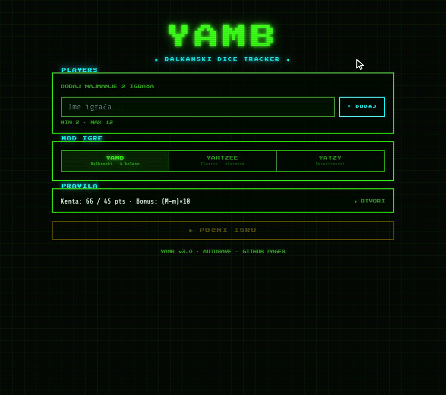
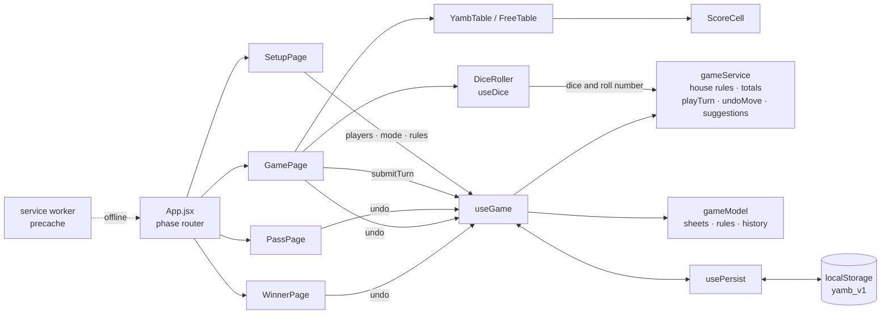
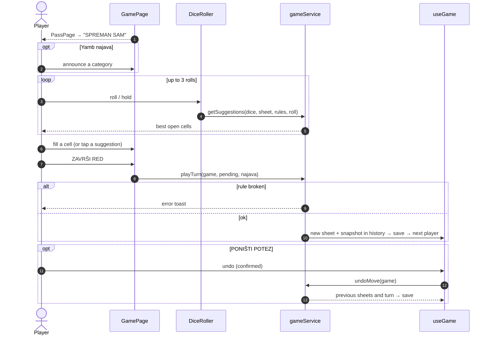

<div align="center">

# 🎲 YAMB Score Tracker

[](https://github.com/pero-grubac/yamb-table/actions/workflows/ci.yml)
[](https://github.com/pero-grubac/yamb-table/actions/workflows/deploy.yml)


**A pass-the-phone scoresheet for Yamb, Yahtzee and Yatzy, with column rules, configurable house rules, najava, an optional dice roller, undo and autosave, in a retro CRT look. Installable and works offline.**

[](https://pero-grubac.github.io/yamb-table/)



</div>

---

## 📌 Project Overview

**YAMB Score Tracker** is a digital scoresheet for **Yamb** (the Balkan four-column game), **Yahtzee** and **Yatzy**. One phone goes around the table: a hand-over screen tells whose turn it is, the player fills their sheet (by hand or from the built-in dice roller), and anyone can look at any other sheet in read-only mode.

The game is saved after every move, so a reload or a closed browser doesn't lose it, and the last moves can be taken back. Once opened, the app works without a connection. No backend.

---

## ✨ Features

- 👥 **2–12 players**, added before the game starts
- 🎮 **Three modes**: Yamb (4 columns), Yahtzee (classic), Yatzy (Scandinavian, with pairs)
- 📋 **Yamb column rules** enforced: Dolje ↓, Gore ↑, Slobodno ★, Najava !
- 📢 **Najava**: announce a category before rolling; if it isn't filled, it is sacrificed (0)
- 📏 **Configurable Yamb house rules** (straight scoring and MAX/MIN bonus), saved with the game, see [Yamb house rules](#-yamb-house-rules)
- 🎲 **Optional dice roller**: three rolls, hold dice, and up to eight ranked suggestions that fill a cell in one click; the straight suggestion follows the chosen rule and the roll number
- ↶ **Undo**: **PONIŠTI POTEZ** takes back the last move (up to the last 10), with a confirmation
- 👁️ **Read-only tabs** for every player's sheet
- 📱 **Hand-over screen** between turns on a shared device
- 🏆 **Winner screen** when every sheet is complete
- 💾 **Autosave** in `localStorage`, with **resume** or **delete** on the start screen
- 📲 **Installable PWA, works offline**: the app and its fonts are precached by a service worker and update themselves on the next visit
- 🕹️ **Retro CRT theme** (Press Start 2P + Share Tech Mono), with every label at a readable size

### 🎮 Modes

| Mode | Description |
|------|-------------|
| **YAMB** | Balkan classic: four columns with fill-order rules, MAX/MIN with a (MAX − MIN) bonus, configurable straight and bonus |
| **YAHTZEE** | American classic: any category in any order, 35-point upper bonus at 63+ |
| **YATZY** | Scandinavian: pairs, small/large straight, 50-point upper bonus at 63+ |

### Yamb columns

| Column | Rule |
|--------|------|
| ↓ Dolje | Top to bottom only |
| ↑ Gore | Bottom to top only |
| ★ Slobodno | Any order, one cell per turn |
| ! Najava | Only the category announced before the first roll |

### 📏 Yamb house rules

Yamb is played differently from table to table, so two rules can be chosen in the collapsible **PRAVILA** panel on the start screen (Yamb mode only). The choice is saved with the game; games saved by older versions load with the defaults. Typing a value by hand is always allowed, the rules only drive the dice-roller suggestions, the row hints and the bonus.

**Straight (kenta)**: five dice in a row, 1-2-3-4-5 or 2-3-4-5-6.

| Option | Points | |
|--------|--------|---|
| 66 u prvom bacanju, inače 45 | 66 if made in the first roll, 45 in the second or third | **default** |
| 66 / 56 / 46 po bacanju | 66, 56 or 46 for the first, second or third roll | |
| Mala 35 / velika 45 (1-5 / 2-6) | 35 for 1-2-3-4-5, 45 for 2-3-4-5-6, any roll | |

The dice roller knows the roll number, so a suggestion shows the right value. (Earlier versions only gave 66 for a "1 to 6" straight, which five dice can't make, so the suggestion was always 45.)

**MAX/MIN bonus**: added to each column's total.

| Option | Bonus | |
|--------|-------|---|
| (MAX − MIN) × 10 | difference times 10 | **default** |
| (MAX − MIN) × broj jedinica u koloni | difference times the number of ones in that column's **1** row | |

With the second option, a column whose **1** row isn't filled yet (or was struck out with 0) has no bonus: ones count as 0 and the bonus row shows **—** until there are ones.

### ↶ Undo

**↶ PONIŠTI POTEZ** appears on the hand-over screen, at the bottom of the game screen and on the winner screen. After a confirmation it restores every sheet to how it was before the last **ZAVRŠI RED** and gives the turn back to the player who made it. The game keeps the last 10 moves, saved together with the game, so undo still works after a reload.

---

## 🛠️ Tech Stack

| Technology | Usage |
|------------|-------|
| React 19 | UI (inline-style components) |
| Vite 8 | Dev server and bundler |
| CSS variables | CRT theme: neon colours, glows, scanlines |
| `localStorage` | Autosave (game, rules and undo history) |
| vite-plugin-pwa (Workbox) | Manifest, service worker, offline precache |
| Self-hosted WOFF2 fonts | Press Start 2P and Share Tech Mono (SIL Open Font License), no Google Fonts request |
| ESLint 10 | Linting |
| `node:test` | Tests for scoring, house rules, column rules, turns, undo and dice suggestions |
| Playwright | End-to-end smoke tests (desktop and mobile Chromium) |
| Lighthouse CI | Performance, accessibility, best-practices and SEO report |
| GitHub Actions + GitHub Pages | CI and deployment |

---

## 📁 Project Structure

```
yamb-table/
├── index.html
├── vite.config.js                 base: '/yamb-table/', PWA manifest and service worker
├── eslint.config.js
├── playwright.config.js           e2e: builds, serves on :4321, desktop + mobile
├── lighthouserc.json
├── public/                        favicon.svg, PWA icons (192, 512, maskable 512), apple-touch-icon
├── src/
│   ├── main.jsx
│   ├── App.jsx                    Phase router: setup → pass → game → winner
│   ├── constants/index.js         Rows and columns per mode, house-rule options, save key, limits
│   ├── models/gameModel.js        Empty sheets, players, rules, get/set cell, old-save upgrade
│   ├── services/gameService.js    Totals, bonuses, straight rule, column rules, playTurn, undo, suggestions
│   ├── hooks/
│   │   ├── useGame.js             Game state and turn flow
│   │   ├── useDice.js             Rolls and held dice
│   │   ├── usePersist.js          localStorage save / load / clear
│   │   └── useToast.js
│   ├── pages/                     SetupPage, PassPage, GamePage, WinnerPage
│   ├── components/                YambTable, FreeTable, ScoreCell, DiceRoller, PlayerTabs, UndoBtn, Btn, Overlay, Toast, Logo
│   ├── assets/fonts/              Self-hosted WOFF2 fonts
│   └── styles/global.css          Fonts, theme variables and CRT effects
├── tests/
│   ├── gameService.test.js        Unit tests (node:test)
│   └── e2e/smoke.spec.js          Playwright smoke tests
├── readme_assets/demo.gif
└── .github/workflows/
    ├── ci.yml                     Unit + lint + build, e2e, Lighthouse on pull requests and branches
    └── deploy.yml                 Lint, test, build and e2e, then deploy to GitHub Pages
```

---

## 📦 Installation

You need [Node.js](https://nodejs.org/) 20 or newer and npm.

```bash
git clone https://github.com/pero-grubac/yamb-table.git
cd yamb-table
npm install
```

No environment variables are needed.

---

## ▶️ Usage

```bash
npm run dev        # http://localhost:5173/yamb-table/
```

1. Add the players (Enter or **+ DODAJ**), pick a mode, for Yamb optionally open **PRAVILA** to pick the house rules, and press **▶ POČNI IGRU**.
2. Hand the phone over; the player presses **▶ SPREMAN SAM**.
3. Fill the sheet directly, or open **BACI KOCKICE** to roll (tap a die to hold it) and tap a suggestion.
4. In Yamb, press **! NAJAVA** before rolling to announce a category.
5. Press **ZAVRŠI RED**. The next player's hand-over screen appears. A wrong entry? **↶ PONIŠTI POTEZ** takes it back.
6. When every sheet is full the winner screen shows the ranking.

On a phone, use the browser's **Add to Home screen** to install it; after the first visit it also opens without a connection.

### Scripts

| Command | Description |
|---------|-------------|
| `npm run dev` | Dev server |
| `npm run build` | Production build to `dist/` |
| `npm run preview` | Serve the production build |
| `npm run lint` | ESLint |
| `npm test` | Unit tests (`node --test`) |
| `npm run test:e2e` | Playwright smoke tests (builds and serves the app on port 4321) |

---

## 🏗️ Architecture



### One turn



---

## 🚀 CI/CD

| Workflow | Runs on | What it does |
|----------|---------|--------------|
| `ci.yml` | Every push (including `main`) and pull request | Three jobs: **test** (lint, unit tests, build), **e2e** (Playwright smoke tests on desktop and mobile Chromium: setup with the rules panel, roll + hold + suggestion with seeded dice, finishing a turn, undo, resume after reload, a Yahtzee turn, offline start, no console errors), **lighthouse** (Lighthouse CI on the build served from `/yamb-table/`, report uploaded as an artifact) |
| `deploy.yml` | After **CI passes on `main`**, or a manual run | Builds and deploys `dist/` to GitHub Pages; the tests already ran in CI |

Deploy is chained to CI (`workflow_run`): a push to `main` is tested once, and only a green run is published, from exactly the commit that was tested. Documentation-only commits start neither.

CI **skips documentation-only changes** (`*.md`, `readme_assets/`, `LICENSE`, `.gitignore`, `.env.example`, `.vscode/`), cache npm downloads and cancel superseded runs.

**One-time setup:** **Settings → Pages → Build and deployment → Source** → **GitHub Actions**.

---

## 🧭 Design Decisions

- **Rules live in one pure module.** `gameService.js` knows nothing about React, which is what makes the column rules, totals and suggestions testable.
- **Sheets are copied, never mutated.** `setCell` and `applyTurn` return new objects, so a rejected turn leaves the sheet exactly as it was.
- **One device, many players.** The hand-over screen hides the previous player's work and makes the turn change explicit.
- **The dice roller is optional.** Many tables roll real dice; the sheet works the same either way.
- **House rules are data, not forks.** The variants live in `constants` and the scoring functions take a `rules` object, so the defaults keep the original behaviour and a new variant is one entry plus one `case`.
- **Undo stores snapshots, not inverse operations.** Each finished turn pushes the previous sheets and turn index onto a 10-item history; undo just restores the last one. It is small, persists with the game and can't drift out of sync.
- **Fonts are in the repo.** Self-hosting the two WOFF2 fonts removes the Google Fonts request and lets the service worker precache everything, so the first offline start looks the same as online.

---

<div align="center">

*Kockice na sto. 🎲*

</div>
